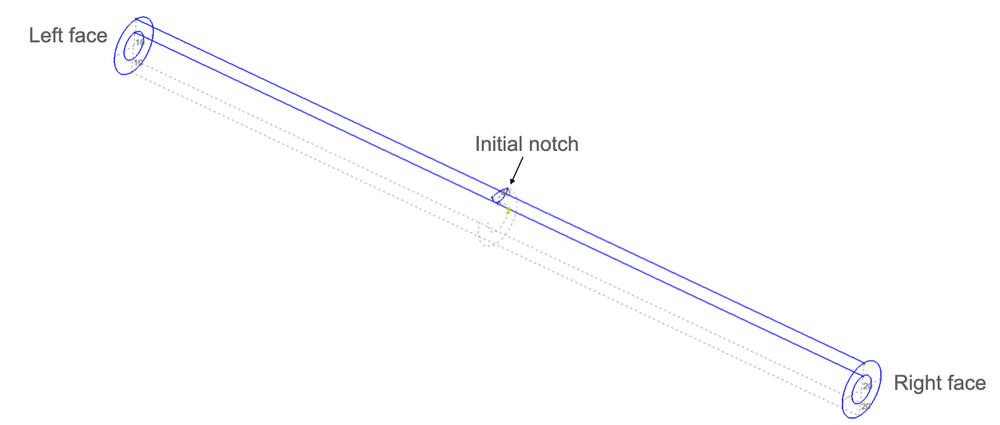
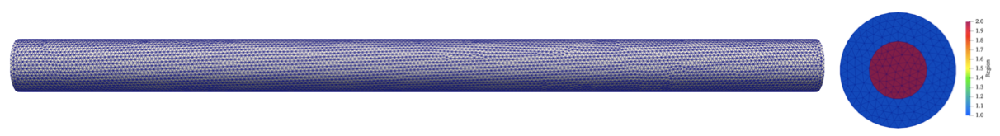
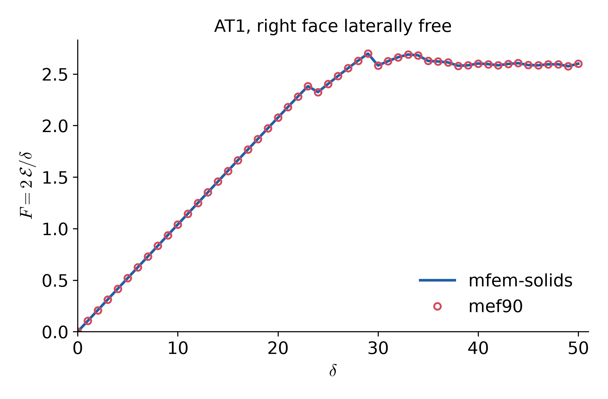
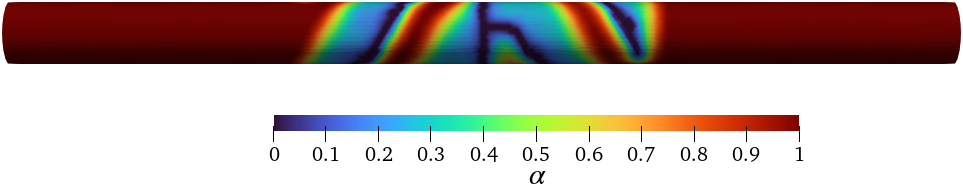
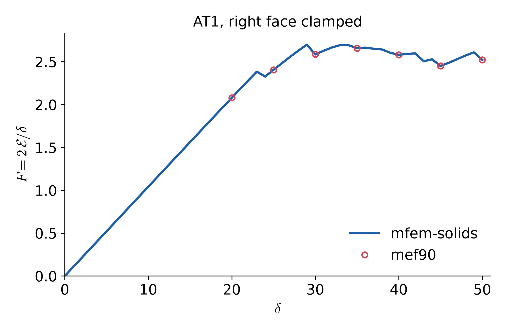
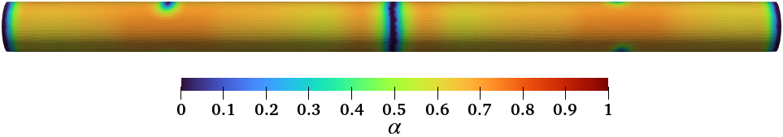

I have never taken a course in fracture mechanics. That gap showed up as soon as I started phase-field simulations. The technique itself is not hard. The energy, the weak forms, the alternate minimization and the bounds on the phase field all follow from a few pages of a paper, and I could implement them without much trouble. What I lacked was insight. I did not know what result to expect, so I could not tell a physical crack from a numerical artifact. When my first runs gave a flat ring where the paper shows a helix, I had no way to judge which one was wrong.

So this note is also a way to build that intuition. I take one well-documented case, the helical crack of a composite tube, and follow it step by step. I check my code against a reference code. Then I change one thing at a time, the boundary condition at one end and the surface energy, and watch how the crack responds.

This note follows two references by Bourdin. The setting of the helical crack comes from **Bourdin, Francfort and Marigo**, *The variational approach to fracture* (J. Elasticity 91, 2008, Section 6). The model and the algorithm follow mef90, Bourdin's phase-field fracture code ([gitlab.com/mef90/mef90](https://gitlab.com/mef90/mef90)). The computations use my own code mfem-solids ([Chongran-Zhao/mfem-solids](https://github.com/Chongran-Zhao/mfem-solids)), built on MFEM.

## 1. Geometry

The body is a composite circular cylinder. The geometry is that of Bourdin, Francfort and Marigo (J. Elasticity 2008, Section 6, Fig. 30).

- $\boldsymbol X = (x, y, z)$ is a point in the Cartesian frame with unit vectors $\boldsymbol e_1, \boldsymbol e_2, \boldsymbol e_3$.
- The axis of the cylinder is the $x$ axis, the line $y = z = 0$ along $\boldsymbol e_1$. The middle cross-section is $x = 0$.
- $r = \sqrt{y^2 + z^2}$ is the distance of $\boldsymbol X$ from this axis.
- $L = 30$ is the length of the cylinder.
- $R = 1$ is its outer radius and $R_\mathrm c = 0.5$ is the radius of the core.

The tube has two regions.

$$
\mathscr B_\mathrm m = \{ \boldsymbol X \mid |x| \le L/2 ,\ R_\mathrm c \le r \le R \} , \qquad \mathscr B_\mathrm c = \{ \boldsymbol X \mid |x| \le L/2 ,\ r \le R_\mathrm c \} . \tag{1}
$$

- $\mathscr B_\mathrm m$ is the matrix. It is brittle.
- $\mathscr B_\mathrm c$ is the core. It does not break. It is perfectly bonded to the matrix.

Three surfaces carry the boundary conditions.

- $\Gamma_\mathrm L$ is the left face $x = -L/2$ and $\Gamma_\mathrm R$ is the right face $x = L/2$.
- $\Gamma_\mathrm K$ is the notch. It is a half disk of radius $a = 0.4$ in the cross-section $x = 0$, centered at $(0, 0, R)$ on the outer surface. It lies in the matrix.

The numbers in the figure are the tags of the parts. In the mesh of Section 3 they are set on elements, not on nodes. A volume tag marks tetrahedra and a surface tag marks triangles.

| Tag | Entity | Part |
|---|---|---|
| 1 | tetrahedra | matrix $\mathscr B_\mathrm m$ |
| 2 | tetrahedra | core $\mathscr B_\mathrm c$ |
| 10 | triangles | left face $\Gamma_\mathrm L$ |
| 20 | triangles | right face $\Gamma_\mathrm R$ |
| 40 | triangles | notch $\Gamma_\mathrm K$ |

- The notch lies inside the matrix. Its triangles are shared by the tetrahedra on its two sides.
- The nodes of the triangles 10 and 20 carry the displacement conditions, and those of 40 carry $\alpha = 0$.

## 2. Energy

The unknowns are the displacement $\boldsymbol u$ and the phase field $\alpha$. The value $\alpha = 1$ is the sound material and $\alpha = 0$ is the crack. The total energy is a sum of integrals over the two regions. It is the potential energy plus the surface energy. The load is a prescribed displacement with no traction and no body force, so the potential energy is the elastic energy alone.

$$
\begin{aligned}
\Pi[\boldsymbol u, \alpha] = {} & \int_{\mathscr B_\mathrm m} \Big( g[\alpha]\, \psi_\mathrm m[\nabla^\mathrm s \boldsymbol u] + G_c \Big( \frac{3 (1 - \alpha)}{16 \varepsilon} + \frac{3 \varepsilon}{4}\, |\nabla \alpha|^2 \Big) \Big)\, dV \\
& + \int_{\mathscr B_\mathrm c} \Big( \psi_\mathrm c[\nabla^\mathrm s \boldsymbol u] + G_c \Big( \frac{3 (1 - \alpha)}{16 \varepsilon} + \frac{3 \varepsilon}{4}\, |\nabla \alpha|^2 \Big) \Big)\, dV .
\end{aligned} \tag{2}
$$

- $\nabla^\mathrm s \boldsymbol u = \tfrac12 \left( \nabla \boldsymbol u + \nabla \boldsymbol u^\mathrm T \right)$ is the symmetric gradient, the small strain.
- $\psi_\mathrm m$ and $\psi_\mathrm c$ are the elastic energies of the matrix and the core.
- $g[\alpha]$ is the degradation function and $G_c$ is the toughness.
- $\varepsilon$ is the length scale. It sets the width of the transition between the sound material and the crack.

Both regions are isotropic and linear elastic.

$$
\psi_\mathrm m[\nabla^\mathrm s \boldsymbol u] = \frac{E_\mathrm m}{2 (1 + \nu_\mathrm m)}\, |\nabla^\mathrm s \boldsymbol u|^2 + \frac{E_\mathrm m\, \nu_\mathrm m}{2 (1 + \nu_\mathrm m) (1 - 2 \nu_\mathrm m)}\, (\nabla \cdot \boldsymbol u)^2 . \tag{3}
$$

- $E_\mathrm m$ is the Young's modulus of the matrix and $\nu_\mathrm m$ is its Poisson's ratio.
- $\nabla \cdot \boldsymbol u = \operatorname{tr} \nabla^\mathrm s \boldsymbol u$ is the volume change.
- $\psi_\mathrm c$ is the same with $E_\mathrm c$ and $\nu_\mathrm c$ of the core.

The degradation function is

$$
g[\alpha] = \eta + (1 - \eta)\, \alpha^2 . \tag{4}
$$

- $\eta$ is the residual stiffness. It keeps $g > 0$ inside the crack.

**Surface energy.** The phase field lives in both regions. The core carries the surface terms but its elastic energy is not degraded. So $\psi_\mathrm c$ does not drive $\alpha$, and the core does not break. The phase field in the core is set by the surface terms alone. This lets a crack in the matrix reach the interface.

The surface energy is that of AT1. Its local term is linear in $1 - \alpha$, and its slope at $\alpha = 1$ is not zero. So $\alpha$ stays at 1 until the elastic energy reaches a threshold. AT1 has an elastic stage. The linear term also lets $\alpha$ go below 0, so AT1 needs the bound $\alpha \ge 0$ of Section 5.

**Parameters.**

| Symbol | Value | Meaning |
|---|---|---|
| $E_\mathrm m$, $E_\mathrm c$ | 1 | Young's modulus |
| $\nu_\mathrm m$, $\nu_\mathrm c$ | 0.2 | Poisson's ratio |
| $G_c$ | 1 | toughness |
| $\varepsilon$ | 0.15 | length scale |
| $\eta$ | $10^{-6}$ | residual stiffness |

## 3. Mesh

The mesh is made with Gmsh.

- The element size is $h = 0.15$, so $h = \varepsilon$.
- There are 27,963 vertices and 141,326 linear tetrahedra.

The tags of the parts are listed in Section 1. They are the physical groups of the mesh.

## 4. Loading and boundary conditions

The load is a displacement $\delta$ of the right face. It increases by one per step.

$$
\delta_n = n , \qquad n = 0, 1, \dots, 50 . \tag{5}
$$

The boundary conditions are

$$
\boldsymbol u = \boldsymbol 0 \ \text{ on } \Gamma_\mathrm L , \qquad \boldsymbol u \cdot \boldsymbol e_1 = \delta_n \ \text{ on } \Gamma_\mathrm R . \tag{6}
$$

The right face is laterally free. Only its axial displacement is prescribed, and its traction along $\boldsymbol e_2$ and $\boldsymbol e_3$ is zero. There is no other traction and no body force.

The notch is a crack from the start. The phase field is held at $\alpha = 0$ on $\Gamma_\mathrm K$ at every step.

## 5. Variational problem

The evolution is discrete in time. At load step $n$ the phase field $\alpha_{n-1}$ of the previous step is known. The displacement and the phase field of step $n$ minimize the total energy (2).

$$
(\boldsymbol u_n, \alpha_n) \in \operatorname*{arg\,min}_{\boldsymbol u \in \mathcal U_n ,\ \alpha \in \mathcal A_n} \Pi[\boldsymbol u, \alpha] . \tag{7}
$$

The admissible sets are

$$
\begin{aligned}
\mathcal U_n & = \big\{ \boldsymbol u \in [H^1(\mathscr B)]^3 \ \big| \ \boldsymbol u = \boldsymbol 0 \ \text{on } \Gamma_\mathrm L ,\ \boldsymbol u \cdot \boldsymbol e_1 = \delta_n \ \text{on } \Gamma_\mathrm R \big\} , \\
\mathcal A_n & = \big\{ \alpha \in H^1(\mathscr B) \ \big| \ 0 \le \alpha \le \alpha_{n-1} \ \text{a.e. in } \mathscr B ,\ \alpha = 0 \ \text{on } \Gamma_\mathrm K \big\} .
\end{aligned}
$$

- $\mathscr B = \mathscr B_\mathrm m \cup \mathscr B_\mathrm c$ is the whole body.
- $H^1(\mathscr B)$ is the space of square-integrable functions on $\mathscr B$ whose first derivatives are square integrable. The boundary values are traces.
- $\mathcal U_n$ is the set of displacements that satisfy (6). It is an affine set and changes with $\delta_n$.
- $\mathcal A_n$ is a closed convex set. It changes with $\alpha_{n-1}$. The first step $n = 0$ starts from $\alpha_{-1} = 1$ in $\mathscr B$, with $\alpha_{-1} = 0$ on $\Gamma_\mathrm K$.
- The bound $\alpha \le \alpha_{n-1}$ is the irreversibility. A crack cannot heal.
- The bound $\alpha \ge 0$ is needed by AT1.

This monotonicity constraint is the one of Giacomini, which the paper mentions after its (8.13). The paper itself uses a threshold set instead.

$\Pi$ is convex in $\boldsymbol u$ at fixed $\alpha$ and convex in $\alpha$ at fixed $\boldsymbol u$. It is not convex in the pair (Section 8.2 of the paper). So (7) is solved for one field at a time, and only stationary points are reached.

The pair $(\boldsymbol u_n, \alpha_n)$ of (7) satisfies two first-order conditions, one for each field. Sections 7 and 8 give them and their discrete forms.

## 6. Finite element space

Both fields use linear shape functions on the tetrahedra. $N^{\mathbf A}$ is the shape function of global node $\mathbf A$, and $\mathbb V^h = \operatorname{span} \{ N^{\mathbf A} \} \subset H^1(\mathscr B)$ is their span. The discrete fields are

$$
\boldsymbol u^h[\boldsymbol X] = \sum_{\mathbf A} N^{\mathbf A}[\boldsymbol X]\, \boldsymbol u^{\mathbf A} , \qquad \alpha^h[\boldsymbol X] = \sum_{\mathbf A} N^{\mathbf A}[\boldsymbol X]\, \alpha^{\mathbf A} . \tag{8}
$$

- $\boldsymbol u^{\mathbf A} \in \mathbb R^3$ and $\alpha^{\mathbf A} \in \mathbb R$ are the nodal values.
- The discrete admissible sets are $\mathcal U_n^h = \mathcal U_n \cap [\mathbb V^h]^3$, $\mathcal A_n^h = \mathcal A_n \cap \mathbb V^h$ and $\mathcal V^h = \mathcal V \cap [\mathbb V^h]^3$.
- In element $\mathbf e$ the local node $\mathbf a$ is the global node $\mathbf A = \ell[\mathbf e, \mathbf a]$.

**From the body to the elements.** The mesh splits $\mathscr B$ into tetrahedra $\Omega^{\mathbf e}$. The mesh follows the interface, so each element lies in $\mathscr B_\mathrm m$ or in $\mathscr B_\mathrm c$, as its tag of Section 3 says. Each element is the image of the reference tetrahedron $\hat\Omega$ under the map $\boldsymbol X^{\mathbf e}[\boldsymbol\xi]$. Let $J^{\mathbf e}[\boldsymbol\xi]$ be its Jacobian determinant. An integral over a region is then a sum of element integrals, each mapped to $\hat\Omega$ and computed by quadrature.
$$
\int_{\mathscr B_\mathrm m} f\, dV = \sum_{\mathbf e \subset \mathscr B_\mathrm m} \int_{\Omega^{\mathbf e}} f\, dV = \sum_{\mathbf e \subset \mathscr B_\mathrm m} \int_{\hat\Omega} f\big[\boldsymbol X^{\mathbf e}[\boldsymbol\xi]\big]\, J^{\mathbf e}[\boldsymbol\xi]\, d\boldsymbol\xi \approx \sum_{\mathbf e \subset \mathscr B_\mathrm m} \sum_q \omega_q\, J_q\, f\big[\boldsymbol X^{\mathbf e}[\boldsymbol\xi_q]\big] .
$$

- $\boldsymbol\xi_q$ and $\omega_q$ are the quadrature points and weights on $\hat\Omega$, of order 2. This rule integrates every term below exactly on linear elements.
- $J_q = J^{\mathbf e}[\boldsymbol\xi_q]$ is the Jacobian determinant at the point $q$.
- In element $\mathbf e$ the global shape function $N^{\mathbf A}$ is the local one $N^{\mathbf a}$ with $\mathbf A = \ell[\mathbf e, \mathbf a]$. It vanishes in the elements that do not touch node $\mathbf A$.
- The local shape functions come from the reference ones, $N^{\mathbf a}[\boldsymbol X^{\mathbf e}[\boldsymbol\xi]] = \hat N^{\mathbf a}[\boldsymbol\xi]$. Their gradients are $\nabla N^{\mathbf a} = (\partial \boldsymbol X^{\mathbf e} / \partial \boldsymbol\xi)^{-\mathrm T}\, \hat\nabla \hat N^{\mathbf a}$.

So a nodal integral is a sum of element contributions. The element arrays are assembled node by node. For a residual,

$$
\mathsf R_{\mathbf A} = \sum_{\mathbf e} \ \sum_{\mathbf a \,:\, \ell[\mathbf e, \mathbf a] = \mathbf A} \mathsf R^{\mathbf e}_{\mathbf a} ,
$$

and the same for a tangent block $\mathsf K_{\mathbf A \mathbf B}$ from $\mathsf K^{\mathbf e}_{\mathbf a \mathbf b}$.

## 7. Displacement problem

**Variational form.** At fixed $\alpha_n$ the first variation of $\Pi$ in $\boldsymbol u$ vanishes at $\boldsymbol u_n$. The variations $\boldsymbol w$ lie in
$$
\mathcal V = \big\{ \boldsymbol w \in [H^1(\mathscr B)]^3 \ \big| \ \boldsymbol w = \boldsymbol 0 \ \text{on } \Gamma_\mathrm L ,\ \boldsymbol w \cdot \boldsymbol e_1 = 0 \ \text{on } \Gamma_\mathrm R \big\} .
$$

$\mathcal V$ is the set of differences of two members of $\mathcal U_n$. The value $\delta_n$ cancels in the difference, so $\mathcal V$ is the same at every step and carries no $n$. For every $\boldsymbol w \in \mathcal V$,

$$
\int_{\mathscr B_\mathrm m} g[\alpha_n]\, \boldsymbol\sigma_\mathrm m[\boldsymbol u_n] : \nabla^\mathrm s \boldsymbol w \, dV + \int_{\mathscr B_\mathrm c} \boldsymbol\sigma_\mathrm c[\boldsymbol u_n] : \nabla^\mathrm s \boldsymbol w \, dV = 0 . \tag{9}
$$

$\boldsymbol\sigma_\mathrm m = \partial \psi_\mathrm m / \partial \nabla^\mathrm s \boldsymbol u$ is the stress of the matrix. From (3) it is

$$
\boldsymbol\sigma_\mathrm m[\boldsymbol u] = \frac{E_\mathrm m}{1 + \nu_\mathrm m}\, \nabla^\mathrm s \boldsymbol u + \frac{E_\mathrm m\, \nu_\mathrm m}{(1 + \nu_\mathrm m) (1 - 2 \nu_\mathrm m)}\, (\nabla \cdot \boldsymbol u)\, \boldsymbol I .
$$

$\boldsymbol\sigma_\mathrm c$ is the same with $E_\mathrm c$ and $\nu_\mathrm c$, and $\boldsymbol I$ is the identity.

**Discrete form.** Find $\boldsymbol u^h_n \in \mathcal U^h_n$ such that (9) holds with $\alpha^h_n$ for every $\boldsymbol w^h \in \mathcal V^h$. With linear elements the boundary conditions of $\mathcal U^h_n$ hold on the faces exactly when they hold at the nodes.
$$
\boldsymbol u^{\mathbf A}_n = \boldsymbol 0 \ \text{ on } \Gamma_\mathrm L , \qquad \boldsymbol u^{\mathbf A}_n \cdot \boldsymbol e_1 = \delta_n \ \text{ on } \Gamma_\mathrm R .
$$

Every $\boldsymbol w^h \in \mathcal V^h$ is a sum of $N^{\mathbf A} \boldsymbol e_k$ over the free components, the pairs of a node $\mathbf A$ and a direction $k$ whose value is not prescribed. On $\Gamma_\mathrm L$ no direction is free. On $\Gamma_\mathrm R$ the directions $k = 2, 3$ are free. So (9) holds for all $\boldsymbol w^h$ when it holds for each $\boldsymbol w^h = N^{\mathbf A} \boldsymbol e_k$. Since $\boldsymbol\sigma$ is symmetric, $\boldsymbol\sigma : \nabla^\mathrm s (N^{\mathbf A} \boldsymbol e_k) = \boldsymbol e_k \cdot \boldsymbol\sigma\, \nabla N^{\mathbf A}$. Collecting the three directions gives the nodal residual $\mathsf R_{\mathbf A}$, a vector of $\mathbb R^3$. It is the derivative of $\Pi[\boldsymbol u^h, \alpha^h_n]$ in the nodal value $\boldsymbol u^{\mathbf A}$. Each free component gives one condition, $\mathsf R_{\mathbf A} \cdot \boldsymbol e_k = 0$.

$$
\mathsf R_{\mathbf A} = \int_{\mathscr B_\mathrm m} g[\alpha^h_n]\, \boldsymbol\sigma_\mathrm m[\boldsymbol u^h]\, \nabla N^{\mathbf A}\, dV + \int_{\mathscr B_\mathrm c} \boldsymbol\sigma_\mathrm c[\boldsymbol u^h]\, \nabla N^{\mathbf A}\, dV .
$$

**Residual.** The rule of Section 6 turns $\mathsf R_{\mathbf A}$ into a sum of element contributions. For node $\mathbf a$ of a matrix element $\mathbf e$,
$$
\mathsf R^{\mathbf e}_{\mathbf a} = \sum_q \omega_q\, J_q \Big[ g[\alpha^h_n]\, \boldsymbol\sigma_\mathrm m[\boldsymbol u^h]\, \nabla N^{\mathbf a} \Big]_{\boldsymbol\xi_q} . \tag{10}
$$

**Tangent.** The tangent is the derivative of the residual in the nodal values, $\mathsf K_{\mathbf A \mathbf B} = \partial \mathsf R_{\mathbf A} / \partial \boldsymbol u^{\mathbf B}$, a $3 \times 3$ block. Since $\partial \boldsymbol u^h / \partial (\boldsymbol u^{\mathbf B} \cdot \boldsymbol e_l) = N^{\mathbf B} \boldsymbol e_l$ and the stress is linear, column $l$ of the block is an integral over the body.

$$
\mathsf K_{\mathbf A \mathbf B}\, \boldsymbol e_l = \int_{\mathscr B_\mathrm m} g[\alpha^h_n]\, \boldsymbol\sigma_\mathrm m[N^{\mathbf B} \boldsymbol e_l]\, \nabla N^{\mathbf A}\, dV + \int_{\mathscr B_\mathrm c} \boldsymbol\sigma_\mathrm c[N^{\mathbf B} \boldsymbol e_l]\, \nabla N^{\mathbf A}\, dV .
$$

With the stress of Section 7 written out, the whole block is

$$
\mathsf K_{\mathbf A \mathbf B} = \int_{\mathscr B_\mathrm m} g[\alpha^h_n] \Big( \frac{E_\mathrm m}{2 (1 + \nu_\mathrm m)} \big( (\nabla N^{\mathbf A} \cdot \nabla N^{\mathbf B})\, \boldsymbol I + \nabla N^{\mathbf B} \otimes \nabla N^{\mathbf A} \big) + \frac{E_\mathrm m\, \nu_\mathrm m}{(1 + \nu_\mathrm m) (1 - 2 \nu_\mathrm m)}\, \nabla N^{\mathbf A} \otimes \nabla N^{\mathbf B} \Big)\, dV + \int_{\mathscr B_\mathrm c} \big( \cdots \big)\, dV ,
$$

where the core integral has $g = 1$ and $E_\mathrm c$, $\nu_\mathrm c$. The rule of Section 6 turns it into element blocks. For nodes $\mathbf a$ and $\mathbf b$ of a matrix element $\mathbf e$,
$$
\mathsf K^{\mathbf e}_{\mathbf a \mathbf b} = \sum_q \omega_q\, J_q \bigg[ g[\alpha^h_n] \Big( \frac{E_\mathrm m}{2 (1 + \nu_\mathrm m)} \big( (\nabla N^{\mathbf a} \cdot \nabla N^{\mathbf b})\, \boldsymbol I + \nabla N^{\mathbf b} \otimes \nabla N^{\mathbf a} \big) + \frac{E_\mathrm m\, \nu_\mathrm m}{(1 + \nu_\mathrm m) (1 - 2 \nu_\mathrm m)}\, \nabla N^{\mathbf a} \otimes \nabla N^{\mathbf b} \Big) \bigg]_{\boldsymbol\xi_q} . \tag{11}
$$

- In a core element $g$ is replaced by 1, and $E_\mathrm m$, $\nu_\mathrm m$ by $E_\mathrm c$, $\nu_\mathrm c$.
- $\mathsf K$ is symmetric and does not depend on $\boldsymbol u^h$. The residual is affine in $\boldsymbol u^h$.

## 8. Phase-field problem

**Variational form.** At fixed $\boldsymbol u_n$ the phase field $\alpha_n$ minimizes $\Pi$ over the convex set $\mathcal A_n$ of Section 5. Its first-order condition is a variational inequality. The competitors $\beta$ lie in $\mathcal A_n$ itself, so unlike $\mathcal V$ they depend on $n$ through the bound $\alpha_{n-1}$. For every $\beta \in \mathcal A_n$,
$$
\int_{\mathscr B_\mathrm m} g'[\alpha_n]\, \psi_\mathrm m[\nabla^\mathrm s \boldsymbol u_n]\, (\beta - \alpha_n)\, dV + G_c \int_{\mathscr B} \Big( - \frac{3}{16 \varepsilon}\, (\beta - \alpha_n) + \frac{3 \varepsilon}{2}\, \nabla \alpha_n \cdot \nabla (\beta - \alpha_n) \Big)\, dV \ge 0 . \tag{12}
$$

$g'$ is the derivative of the degradation (4).

$$
g'[\alpha] = 2 (1 - \eta)\, \alpha , \qquad g'' = 2 (1 - \eta) .
$$

Where neither bound is active, (12) holds with equality for all variations.

**Discrete form.** Find $\alpha^h_n \in \mathcal A^h_n$ such that (12) holds with $\boldsymbol u^h_n$ for every $\beta^h \in \mathcal A^h_n$. With linear elements $\alpha^h_n - \alpha^h_{n-1}$ is linear in each element. So the bounds of $\mathcal A^h_n$ hold everywhere exactly when they hold at the nodes.

$$
0 \le \alpha^{\mathbf A}_n \le \alpha^{\mathbf A}_{n-1} \quad \text{for every node } \mathbf A , \qquad \alpha^{\mathbf A}_n = 0 \ \text{ on } \Gamma_\mathrm K . \tag{13}
$$

Every $\beta^h - \alpha^h_n$ is a sum of $(\beta^{\mathbf A} - \alpha^{\mathbf A}_n)\, N^{\mathbf A}$ over the nodes $\mathbf A$. So the discrete (12) reads $\sum_{\mathbf A} \mathsf R_{\mathbf A}\, (\beta^{\mathbf A} - \alpha^{\mathbf A}_n) \ge 0$ for all $\beta^{\mathbf A}$ within the bounds (13). Here $\mathsf R_{\mathbf A}$ is the left side of (12) with $\beta - \alpha_n$ replaced by $N^{\mathbf A}$, a scalar. It is the derivative of $\Pi[\boldsymbol u^h_n, \alpha^h]$ in the nodal value $\alpha^{\mathbf A}$.

$$
\mathsf R_{\mathbf A} = \int_{\mathscr B_\mathrm m} g'[\alpha^h]\, \psi_\mathrm m[\nabla^\mathrm s \boldsymbol u^h_n]\, N^{\mathbf A}\, dV + G_c \int_{\mathscr B} \Big( - \frac{3}{16 \varepsilon}\, N^{\mathbf A} + \frac{3 \varepsilon}{2}\, \nabla \alpha^h \cdot \nabla N^{\mathbf A} \Big)\, dV .
$$

Each node can be varied alone, so each node gives one condition.

$$
\mathsf R_{\mathbf A} = 0 \ \text{ if } 0 < \alpha^{\mathbf A}_n < \alpha^{\mathbf A}_{n-1} , \qquad \mathsf R_{\mathbf A} \ge 0 \ \text{ if } \alpha^{\mathbf A}_n = 0 , \qquad \mathsf R_{\mathbf A} \le 0 \ \text{ if } \alpha^{\mathbf A}_n = \alpha^{\mathbf A}_{n-1} .
$$

**Residual.** The rule of Section 6 turns $\mathsf R_{\mathbf A}$ into a sum of element contributions. For node $\mathbf a$ of a matrix element $\mathbf e$,

$$
\mathsf R^{\mathbf e}_{\mathbf a} = \sum_q \omega_q\, J_q \left[ \left( g'[\alpha^h]\, \psi_\mathrm m[\nabla^\mathrm s \boldsymbol u^h_n] - \frac{3\, G_c}{16 \varepsilon} \right) N^{\mathbf a} + \frac{3}{2}\, G_c\, \varepsilon\, \nabla \alpha^h \cdot \nabla N^{\mathbf a} \right]_{\boldsymbol\xi_q} . \tag{14}
$$

**Tangent.** The tangent is the derivative of the residual in the nodal values, $\mathsf K_{\mathbf A \mathbf B} = \partial \mathsf R_{\mathbf A} / \partial \alpha^{\mathbf B}$, a scalar. Since $\partial \alpha^h / \partial \alpha^{\mathbf B} = N^{\mathbf B}$, it is an integral over the body.

$$
\mathsf K_{\mathbf A \mathbf B} = \int_{\mathscr B_\mathrm m} g''\, \psi_\mathrm m[\nabla^\mathrm s \boldsymbol u^h_n]\, N^{\mathbf A} N^{\mathbf B}\, dV + G_c \int_{\mathscr B} \frac{3 \varepsilon}{2}\, \nabla N^{\mathbf A} \cdot \nabla N^{\mathbf B}\, dV .
$$

The rule of Section 6 turns it into element blocks. For nodes $\mathbf a$ and $\mathbf b$ of a matrix element $\mathbf e$,

$$
\mathsf K^{\mathbf e}_{\mathbf a \mathbf b} = \sum_q \omega_q\, J_q \left[ g''\, \psi_\mathrm m[\nabla^\mathrm s \boldsymbol u^h_n]\, N^{\mathbf a} N^{\mathbf b} + \frac{3}{2}\, G_c\, \varepsilon\, \nabla N^{\mathbf a} \cdot \nabla N^{\mathbf b} \right]_{\boldsymbol\xi_q} . \tag{15}
$$

- In a core element the terms with $g'$ and $g''$ are dropped and the surface terms stay.
- $\mathsf K$ is symmetric and does not depend on $\alpha^h$. The residual is affine in $\alpha^h$.

**Check.** Over the 50 steps no nodal value $\alpha^{\mathbf A}_n$ of the saved fields ever increased. The largest $\alpha^{\mathbf A}_n - \alpha^{\mathbf A}_{n-1}$ over all nodes and steps is exactly 0.

## 9. Alternate minimization

Each load step $n$ solves the displacement problem of Section 7 and the phase-field problem of Section 8 in turn. $j$ counts these alternate iterations within the step.

**Start of the step.** The bounds (13) are set from $\alpha^h_{n-1}$. The iteration starts from the fields of the previous step, $\alpha^{h,(0)} = \alpha^h_{n-1}$ and $\boldsymbol u^{h,(0)} = \boldsymbol u^h_{n-1}$, with the new boundary values $\delta_n$.

**Iteration $j$.**

1. Displacement. Solve Section 7 with $\alpha^h = \alpha^{h,(j)}$ for $\boldsymbol u^{h,(j+1)}$. The solver is Newton's method with $\mathsf K\, \Delta \mathsf u = - \mathsf R$ on the free components. The problem is linear, so one step solves it. The prescribed components, all three on $\Gamma_\mathrm L$ and the axial one on $\Gamma_\mathrm R$, take their values from the discrete boundary conditions and are left out of the system. The Newton tolerances are $10^{-8}$ relative and $10^{-10}$ absolute. The linear solver is GMRES preconditioned by algebraic multigrid.
2. Phase field. Solve Section 8 with $\boldsymbol u^h_n = \boldsymbol u^{h,(j+1)}$ for $\alpha^{h,(j+1)}$. The solver is a reduced-space active-set Newton method with a line search. At each Newton step the nodes at a bound whose residual points outward are held there, and the Newton system is solved on the other nodes. The problem is linear, but the bounds make it a complementarity problem, so it takes several steps. The Newton tolerances are $10^{-5}$ relative, $10^{-7}$ absolute and $10^{-7}$ on the step.
3. Stop when the phase field stops changing.

$$
\max_{\mathbf A} \big| \alpha^{\mathbf A,(j+1)} - \alpha^{\mathbf A,(j)} \big| \le 10^{-3} . \tag{16}
$$

The maximum runs over all nodes $\mathbf A$. With linear elements it equals $\| \alpha^{h,(j+1)} - \alpha^{h,(j)} \|_\infty$ over $\mathscr B$, since the difference is linear in each element. The last iterates are the fields of the step, $\boldsymbol u^h_n$ and $\alpha^h_n$.

- The step stops with an error after 3,000 iterations.
- With exact solves, neither half of an iteration raises $\Pi$. So $\Pi$ does not increase over the iterations of a step.

## 10. Results: Energies

The elastic energy and the surface energy are

$$
\mathcal E = \int_{\mathscr B_\mathrm m} g[\alpha^h]\, \psi_\mathrm m[\nabla^\mathrm s \boldsymbol u^h]\, dV + \int_{\mathscr B_\mathrm c} \psi_\mathrm c[\nabla^\mathrm s \boldsymbol u^h]\, dV , \qquad \mathcal S = G_c \int_{\mathscr B_\mathrm m} \left( \frac{3 (1 - \alpha^h)}{16 \varepsilon} + \frac{3 \varepsilon}{4}\, |\nabla \alpha^h|^2 \right) dV . \tag{17}
$$

$\mathcal E$ counts both regions, the degraded matrix and the core. $\mathcal S$ counts the matrix only and leaves out the surface terms of the core. So $\mathcal E + \mathcal S$ is not exactly $\Pi$ of (2). mef90 reports both energies in the same way, which makes the two codes directly comparable.

The table compares mfem-solids with mef90 on the same mesh, with the same parameters and the same boundary conditions. mef90 prints six significant digits.

| $\delta$ | $\mathcal E$ mfem-solids | $\mathcal E$ mef90 | $\mathcal S$ mfem-solids | $\mathcal S$ mef90 |
|---|---|---|---|---|
| 1 | 0.05203881 | 0.0520388 | 0.4704549 | 0.470455 |
| 20 | 20.77168 | 20.7717 | 0.4877235 | 0.487723 |
| 25 | 30.03913 | 30.0391 | 1.997766 | 1.99777 |
| 30 | 38.74460 | 38.7446 | 4.704835 | 4.70483 |
| 35 | 45.97985 | 45.9798 | 9.265382 | 9.26538 |
| 40 | 52.04207 | 52.0421 | 14.55318 | 14.5532 |
| 45 | 58.21062 | 58.2106 | 19.71113 | 19.7111 |
| 50 | 65.00358 | 65.0036 | 24.35976 | 24.3598 |

- The two codes agree at every step to the digits mef90 prints. From $\delta = 5$ on, the largest relative difference is $3 \times 10^{-6}$ in $\mathcal E$ and $2 \times 10^{-6}$ in $\mathcal S$.
- They take the same number of alternate iterations at every step, and their nodal phase fields differ by less than $10^{-8}$ at $\delta = 30$, 35, 40, 45 and 50.
- $\mathcal S$ stays near its initial value 0.47 up to $\delta = 23$. This is the elastic stage.
- At $\delta = 24$ the notch starts to grow and $\mathcal S$ jumps from 0.546 to 1.842.
- $\mathcal E$ grows at every step except $\delta = 30$, where the crack closes into a ring around the core.
- The steps with many iterations are $\delta = 25$ (124), 34 (211), 35 (227), 38 (185) and 42 (305). The 50 steps take 3,413 iterations in all.

**Reaction force.** At a converged step $\alpha_n$ is fixed and the displacement problem is linear, with $\delta_n$ as its only load. So $\boldsymbol u_n$ is proportional to $\delta_n$ and $\mathcal E$ is quadratic in it. The reaction on $\Gamma_\mathrm R$ along $\boldsymbol e_1$ is then

$$
F_n = \frac{\partial \mathcal E}{\partial \delta}\bigg|_{\alpha_n} = \frac{2\, \mathcal E_n}{\delta_n} . \tag{18}
$$

- $F$ grows linearly up to $\delta = 23$, where $F = 2.38$.
- It drops at $\delta = 24$, when the notch starts to grow, and at $\delta = 30$, after its peak $F = 2.70$ at $\delta = 29$.
- From $\delta = 30$ on it stays on a plateau near 2.6 while the two branches grow.
- The force of mef90, from its elastic energy by (18), lies on the curve of mfem-solids at every step.

## 11. Results: Crack shape

This section follows the crack from the notch to two helices. The figures show the phase field on the outer surface. Dark blue is the crack, $\alpha \approx 0$, and red is sound material, $\alpha = 1$.

*Load step $n = 0$, $\delta = 0$, the notch only.*

*Load step $n = 24$, $\delta = 24$, the notch starts to grow.*

*Load step $n = 30$, $\delta = 30$, the ring around the core.*

*Load step $n = 40$, $\delta = 40$, two helices.*

*Load step $n = 45$, $\delta = 45$, two helices.*

*Load step $n = 50$, $\delta = 50$, two helices.*

The growth has three stages.

1. **Elastic stage**, $\delta \le 23$. Only the notch is cracked. The rest of the tube is sound.
2. **Ring**, $\delta = 24$ to 30. At $\delta = 24$ the notch starts to grow. It spreads through the thickness and around the circumference, but stays in the cross-section $x = 0$. At $\delta = 30$ it closes into a ring around the core.
3. **Two helices**, $\delta = 30$ to 50. Two branches leave the ring, one to the left and one to the right. Each winds around the core as it grows along the axis, so each is a helix. The two wind in opposite senses, like a left-handed and a right-handed screw. They grow at about the same rate, and the crack stays nearly antisymmetric about the notch.

**How far the crack has spread.** A node is taken as cracked when $\alpha^{\mathbf A} < 0.1$. The table gives the smallest and the largest $x$ of the cracked matrix nodes, that is, how far the crack reaches to the left and to the right of the notch.

| $\delta$ | 24 | 28 | 30 | 32 | 35 | 38 | 40 | 42 | 45 | 48 | 50 |
|---|---|---|---|---|---|---|---|---|---|---|---|
| left end | -0.12 | -0.16 | -0.60 | -0.87 | -1.88 | -2.73 | -3.07 | -3.61 | -4.29 | -5.04 | -5.55 |
| right end | 0.23 | 0.32 | 0.72 | 0.99 | 1.67 | 2.51 | 2.93 | 3.46 | 4.17 | 4.71 | 5.10 |

Up to $\delta = 28$ the crack stays within 0.3 of the notch, which is the ring stage. From $\delta = 30$ on, both ends move out by about 0.25 per load step, so the two branches grow at the same rate.

**Shape of the helices.** The pitch is the distance along the axis over which a branch makes one full turn. At each $x$ the angle of the crack around the axis is measured, and a straight line is fitted to the angle against $x$ for $|x| > 1.5$. At $\delta = 50$ the pitch is about 3.6 on the left and 3.3 on the right. Each branch has made about one turn. At the same $|x|$ the two branches lie about 170° apart around the axis.

## 12. Results: Right face clamped

This section repeats the computation with one change. The right face is clamped as well, so all three components of the displacement are prescribed there. It moves along the axis by $\delta_n$ and cannot move in the transverse directions.

$$
\boldsymbol u = \boldsymbol 0 \ \text{ on } \Gamma_\mathrm L , \qquad \boldsymbol u = \delta_n\, \boldsymbol e_1 \ \text{ on } \Gamma_\mathrm R .
$$

The geometry, the mesh, the parameters and the algorithm are those of Sections 1 to 9.

*Load step $n = 0$, $\delta = 0$, the notch only.*

*Load step $n = 24$, $\delta = 24$, the notch starts to grow.*

*Load step $n = 30$, $\delta = 30$, the ring around the core.*

*Load step $n = 40$, $\delta = 40$, two branches.*

*Load step $n = 45$, $\delta = 45$, the left branch after a jump.*

*Load step $n = 50$, $\delta = 50$, the left branch after a jump, the right branch stopped.*

Up to $\delta = 34$ the crack is that of Section 11. The ends of the cracked range agree at every step, and the energies differ by less than 0.4%, the clamped right face being slightly stiffer. From $\delta = 35$ on the two cases part.

1. **Elastic stage**, $\delta \le 23$. Only the notch is cracked, as before.
2. **Ring**, $\delta = 24$ to 30. As in Section 11, the notch reaches the core at $\delta = 24$ and spreads around the circumference in its own cross-section. At $\delta = 30$ it closes into a ring around the core.
3. **Two branches**, $\delta = 30$ to 38. Two branches leave the ring, one to each side, at about the same rate.
4. **One branch**, $\delta = 38$ to 50. The right branch slows down and stops at $x = 2.78$ at $\delta = 42$. The left branch goes on alone. It grows by jumps of about 1.5 in $x$, about half a turn, at $\delta = 43$, 45 and 50, and slowly between them.

**How far the crack has spread.** The table gives the two ends of the cracked range in $x$, as in Section 11.

| $\delta$ | 30 | 35 | 40 | 42 | 43 | 44 | 45 | 48 | 50 |
|---|---|---|---|---|---|---|---|---|---|
| left end | -0.60 | -1.72 | -3.53 | -4.13 | -5.56 | -5.93 | -7.43 | -7.63 | -9.17 |
| right end | 0.72 | 1.60 | 2.56 | 2.78 | 2.78 | 2.78 | 2.78 | 2.78 | 2.78 |

At $\delta = 50$ the crack spans $x \in [-9.17, 2.78]$. The left branch winds 3.0 turns, with a pitch of about 2.6 by the fit of Section 11.

**Reaction force.** Each jump of the left branch shows up as a drop of the force (18), at $\delta = 43$, 45 and 50. With the right face laterally free the force stays on a plateau instead.

So clamping the right face breaks the near antisymmetry of Section 11. One branch stops, and the other grows into a longer helix.

## 13. Results: AT2

This section replaces the AT1 surface energy of (2) by the AT2 one, in both regions.

$$
G_c \Big( \frac{(1 - \alpha)^2}{4 \varepsilon} + \varepsilon\, |\nabla \alpha|^2 \Big) .
$$

**What is the same and what differs.** The run is that of Section 12, with the clamped right face, and not that of Sections 4 to 11.

- The same as Section 12. The geometry, the mesh, the materials, $G_c = 1$, $\varepsilon = 0.15$, $\eta = 10^{-6}$, the degradation (4), the load steps $\delta_n = n$ up to 50, the clamped left and right faces, the bounds $0 \le \alpha \le \alpha_{n-1}$, and every tolerance of Section 9.
- Different from Section 12. Only the surface energy, AT2 in place of AT1. The phase-field residual and tangent change accordingly. The local term contributes $G_c\, (\alpha - 1) / (2 \varepsilon)$ to the residual (14) and $G_c / (2 \varepsilon)$ to the tangent (15), and the gradient coefficient is $2\, G_c\, \varepsilon$ in place of $\tfrac32\, G_c\, \varepsilon$.
- Different from Sections 4 to 11. The surface energy, and the right face, which is clamped here and laterally free there.

The local term $(1 - \alpha)^2$ has a zero slope at $\alpha = 1$. So AT2 has no elastic stage, and $\alpha$ drops below 1 everywhere as soon as the load starts. The bounds are kept as with AT1. The lower bound is still reached in the discrete problem. At $\delta = 50$, 197 nodes off the notch sit at $\alpha = 0$.

*Load step $n = 0$, $\delta = 0$, the notch only.*

*Load step $n = 24$, $\delta = 24$, the notch has not grown, but the whole tube is slightly damaged.*

*Load step $n = 30$, $\delta = 30$, the notch grows in its own cross-section.*

*Load step $n = 40$, $\delta = 40$, still a flat crack at the notch.*

*Load step $n = 45$, $\delta = 45$, the far field damaged by about one third.*

*Load step $n = 50$, $\delta = 50$, flat cracks at the notch, at $x \approx \pm 8.7$ and at the two ends.*

The growth is quite different from AT1.

1. **Spread damage**, from $\delta = 1$ on. The whole tube is damaged a little, and more with each step. The notch does not grow up to $\delta = 26$.
2. **Flat growth at the notch**, $\delta = 27$ to 45. At $\delta = 27$ the notch starts to grow. It spreads around the circumference but stays in $x \in [-0.2, 0.3]$, in its own cross-section. At $\delta = 40$ it covers two thirds of the circumference. It never winds along the axis.
3. **Rings away from the notch**, $\delta = 46$ to 50. At $\delta = 46$ two flat partial rings open at once, at $x \approx -8.6$ and $x \approx 8.9$. Each is about 0.4 wide in $x$ and covers about 7/12 of the circumference. At $\delta = 48$ two more open at the faces $x = \pm 15$, where the clamped faces meet the core.

## Summary

- With AT1 the crack grows as a helix around the unbreakable core.
- AT1 has an elastic stage. The notch starts to grow at $\delta = 24$, and the material away from the crack stays sound.
- The notch first closes into a ring at $\delta = 30$. Two branches of opposite hand then grow from it together, nearly antisymmetric about the notch.
- At $\delta = 50$ each branch winds about one turn, with a pitch of about 3.5.
- The reaction force stays on a plateau near 2.6 while the branches grow.
- With the right face clamped, the right branch stops at $\delta = 42$ and the left one grows alone, to 3.0 turns at $\delta = 50$.
- With AT2 the whole tube is damaged before the notch grows. No helix forms, and the tube breaks at several flat rings.

Looking back, I am still skeptical of simulations of brittle cracks like this one. Too many things are out of my control.

- The mesh matters, both its fineness and its symmetry. A crack follows the mesh when it has a choice, and a symmetric mesh can hide a helix.
- The parameters matter. The paper does not give the length scale, and the choice between AT1 and AT2 alone decides whether a helix forms at all.
- Every run is expensive. The case of Section 11 takes 3,413 alternate iterations over 50 load steps, about 3.4 hours on 8 cores. The clamped case of Section 12 takes 4,133 iterations and about 3.2 hours. The alternate minimization converges slowly whenever the crack grows.
- A monolithic Newton method would solve both fields at once and could be faster. But $\Pi$ is not jointly convex in $\boldsymbol u$ and $\alpha$, so nothing guarantees that it converges.

Each of these leaves me unsure whether a crack I see is the answer of the model or an accident of the computation.

Prof. Kesari gave us an encouraging way to think about this. If someone finds a flaw in your theory with an experiment, you should thank them. They could only do that because they reproduced your work, which means your work was complete enough to be reproduced. A theory rests on assumptions, and whether those assumptions hold does not decide how good the research is. A theory that others test and correct is not a bad theory. It is quite the opposite.

I take this note in the same spirit. The model and the code here are explicit enough that anyone can rerun them and find out where they fail.
